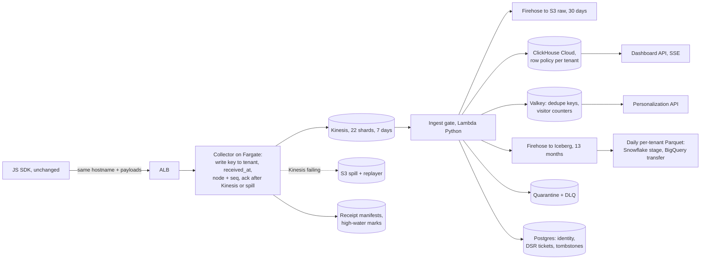

# Engineer 004: Real-time analytics pipeline

**Brief version: 2026-07.** Fixture `fixtures/event_sample.jsonl`, sha256 `1aeb24b415009e89fcf8acb5a178410faf216dc17b16920d9849ecc8bbb24235`, 25 lines [Observed]. Artifact: this repo; `make all` regenerates every [Observed] number below using only the Python standard library. Full tables and arithmetic: `docs/DETAILS.md`.

## Written answer

### 0. Decision

Keep the SDK hostname and wire format. A thin collector maps the write key to a tenant, stamps server time and a per-node sequence number, and acks only after a durable write: Kinesis, or an S3 spill while Kinesis is failing. One Python ingest gate (Lambda on Kinesis) puts every record in exactly one counted bucket: accepted, duplicate, quarantined, dead-letter, control or suppressed. Accepted events feed ClickHouse Cloud (dashboards), Valkey (personalization) and an Iceberg lake (exports, deletion). A normal month is ~$6.9K [Estimated] (`out/cost_sheet.md`) against a $50K ceiling [Assumed] (brief). The constraint is two engineers, not money: everything is managed, and the code is Python.

### 1. The fixture, class by class

`tools/fixture_audit.py` runs the gate over the file: 21 accepted, 1 duplicate, 1 quarantined, 1 dead-letter, 1 control [Observed] (`out/fixture_audit.md`).

| Class | event_ids [Observed] | Handling |
|---|---|---|
| Retry duplicate | evt-0002 (lines 2, 5) | Dedupe on (tenant_id, event_id) + content hash; a different hash is quarantined. |
| Clock ahead | evt-0005 +47 s; evt-0006 +65 min; evt-0016 +1 year | Past +5 s [Assumed], use received_at; partition on server time. |
| Legacy payload | evt-0009: `pageview`, `page_path` | Map to the canonical shape and flag; it still counts (tested). |
| No tenant | evt-0011 | Quarantine; never infer one. |
| PII | evt-0007 `contact_email`, `phone` | HMAC (per-tenant key) before every store but the raw archive. |
| Scanner | evt-0012..0015, 4 views in 50 ms | Flag, keep, exclude from dashboards and segments. |
| Privacy request | evt-0017 GDPR delete | Unverified deletion ticket, not analytics. |
| Truncated JSON | evt-0020 | Dead-letter and count; no repair. |
| Null, client counter | evt-0004 null referrer; evt-0019 `count_today` | Store empty string; segments ignore client counters. |
| Identity | identify evt-0003, 0008, 0022; evt-0016, 0024 | Identify links ids per tenant; others stay unmerged, since page code can set user_id. |

**Not taken at face value.**

1. **evt-0017.** Unauthenticated, so anyone can delete anyone. And u-1077 has no events by user_id: the only data in scope, evt-0006, is reached via the request's own unconfirmed anon-77a [Observed] (`out/fixture_audit.json`).
2. **evt-0019's "viewed pricing 3x".** A client claim; the sample shows one pricing view for u-5511 (evt-0001) [Observed].
3. **Matching counts.** t-042 has 2 /pricing views naively and 2 after the gate [Observed], but different events: the naive count includes bot evt-0012 and misses legacy evt-0009. So migration also samples event ids.

**Not concluded from 25 rows:** production rates, the SDK's retry policy, where the 3% loss happens [Assumed] (brief), and latency.

### 2. Architecture



| Layer | Choice | Rejected, and why |
|---|---|---|
| Edge | ALB + Node collector on Fargate, ~$170/mo [Estimated] | **API Gateway:** ~$1.4K/mo [Estimated]. |
| Buffer | Kinesis, provisioned for the spike | **On-demand:** dearer at Black Friday; throttles past 2x the prior peak [Benchmarked]. |
| Processing | Python Lambda, batch 1,000 (default 100 [Benchmarked]), poison batches to SQS | **Managed Flink:** Java-first, for state that is just counters. |
| Dashboards | ClickHouse Cloud | **Self-managed:** ~$600/mo cheaper [Estimated], ~0.25 engineer [Assumed]. |
| Lake | Firehose to Iceberg | **Warehouse connectors in v1:** auth and schema drift each. |

**Event and identity:** keyed (tenant_id, event_id) with client and server time, node, sequence, flags and JSON properties (`schema/clickhouse.sql`). Identity edges live in Postgres, resolved at query time; no probabilistic merges. **Personalization:** one Valkey lookup at render. "Viewed pricing 3x" is three non-bot pricing views by one linked person in 7 days [Assumed].

**ClickHouse:** a ReplacingMergeTree on (tenant_id, event_id). Copies collapse only within a partition, so exact reads use `LIMIT 1 BY`, not FINAL. A nightly repair rebuilds the per-minute rollup minus late-flagged bots (`schema/jobs.sql`; not executed).

### 3. Sizing and cost

- **Volume:** 50M events/day [Assumed] is 579/s [Estimated]; a 3x peak [Assumed] times the 10x spike is 17,361/s [Estimated]. At 1,000 records/s per shard [Benchmarked] and 1.25 headroom [Assumed]: 22 shards, 0.8 MB/s each at 1 KB/event [Assumed].
- **Gate CPU:** ~50K records/s on one M4 core [Observed] (`out/drill_clean.json`, varies by run), against 789/s per shard [Estimated].

| `tools/cost_sheet.py` [Estimated] | Normal month | Black Friday month (72 h at spike) | Stress: all hours at spike |
|---|---:|---:|---:|
| Events in the month | 1.5B | 5.85B (3.9x) | 45.6B (30.4x) |
| Total, incl. staging and 20% reserve | $6,913 | $8,275 | $20,719 |

Prices are Price List skus [Benchmarked], checked by `tests/test_prices.py`. **Not included:** legacy's bill during the parallel run. **Latency p95:** ~2.6 s [Estimated], unmeasured; Phase 1 can't exit until a canary shows under 5 s.

### 4. Guarantees and failure design

- **Collector to Kinesis:** at-least-once. The 2xx comes only once every record is in (a 200 can carry `FailedRecordCount`). If Kinesis fails for 2 s [Assumed], the collector spills to S3 and replays later.
- **Kinesis to stores:** at-least-once, idempotent effects. A batch's dedupe keys (Valkey) commit only after ClickHouse and Firehose ack; a sink error aborts the batch and Kinesis redelivers it. Counters increment in the same per-tenant Valkey script as the commit.
- **Drill:** 1M events, 70 injected sink failures and crashes [Observed]: both sinks hold every expected event and nothing else; no counter double-incremented (`out/drill_clean.json`). My first version, marking events seen before the sinks acked, lost 6,416 from ClickHouse and 13,321 from the lake on the same input [Observed] (`out/drill_dedupe_before_sink.json`). A client-time bot window made 268 false flags, now 0 [Observed] (`out/bot_window_regression.json`).
- **Loss is detected, not assumed:** each collector persists its acked high-water mark every second; any gap below it is loss. Of 214 records dropped between collector and gate, the marks found all 214 [Observed] (`out/drill_loss.json`).
- **Lake and backpressure:** a Firehose 200 is not an Iceberg commit, so a daily per-tenant count compares lake to ClickHouse. Kinesis holds 7 days; iterator age past 1 h [Assumed] pages someone.

### 5. Compliance as layout

**Isolation:** the tenant comes from the write key only. ClickHouse lets a user that no row policy names read every row (ClickHouse docs), so each table has a permissive deny-all policy (`USING 0 TO ALL`) beside the per-tenant ones (`schema/access.sql`). **PII:** HMAC'd everywhere but raw and dead-letter bytes, which are encrypted and expire at 30 days [Assumed]. **Deletion:** a tenant-verified request writes tombstones for user_id plus linked anonymous ids, enforced by the gate on every path, replays included (tested on evt-0006 [Observed]); stores delete daily. Every copy is gone within 14 days [Assumed], inside GDPR's one month and CCPA's 45 days [Benchmarked].

### 6. Migration

| Phase | Weeks | Ships | Exit / rollback |
|---|---|---|---|
| 0 Measure | 1-3 | Canaries measure legacy loss; list legacy readers | Baseline |
| 1 Shadow | 3-8 | Legacy tees to Kinesis per tenant; nightly gate | A1-A4 hold 14 days [Assumed] |
| 2 MVP | 8-12 | Real-time dashboards for opt-in tenants | Read flag, seconds |
| 3 Edge | 13-20 | Collector takes the hostname at ALB weights 1→100%; adapter feeds legacy Postgres | Weight to zero on 5xx, latency, A1 failure |
| 4 Full | 21-26 | Segments, triggers, exports; legacy read-only, then off | Per-cohort flag |

**"Data accuracy verified"** means four checks hold in every tenant-hour. `tools/cutover_gate.py` runs them and exits 0 PASS, 3 HOLD, 2 ROLLBACK.

**A1 completeness:** edge = the sum of all six buckets, exactly; surplus fails too. **A2 quality:** quarantine + dead-letter ≤0.5% [Assumed]; below 1,000 records [Assumed], any bad record needs review. **A3 denominator:** legacy rows ≤ edge count. **A4 freshness:** canary p95 under 5 s; unmeasured means HOLD.

1,000 sampled event_ids a day [Assumed] are looked up in both stores (the t-042 lesson). On drill data the clean run ends in HOLD and the loss run in ROLLBACK, naming 92 tenants [Observed] (`out/cutover_*.txt`). **People:** A owns edge and migration; B owns gate and ClickHouse; mid-levels build the UI from Phase 2.

### 7. Trade-offs and scope

**Accepted:** duplicates the store collapses, not exactly-once; bad-clock counters wait for the nightly rebuild; one region. **MVP leaves out** triggers, segment builder, warehouse connectors, self-serve deletion. **With more time or budget:** SDK v2 with sequence numbers, multi-region, per-tenant KMS keys.

---

## Operating artifact

`ingest_gate/gate.py` (the gate the Lambda wraps); `tools/` (fixture audit, spike drill, bot-window regression, cutover gate, cost sheet); `schema/` (ClickHouse DDL and jobs, not executed); `tests/` (45 tests [Observed]); `out/` (committed outputs); `consult/` (model transcripts, decision log).

## Artifact access

Repo: https://github.com/AvichalDwivedi2205/engineer-004-pipeline · Dashboard of the `make all` outputs: https://claude.ai/artifact/GFVRwpKHsnk2vt7sGyrMRN

```
$ git clone https://github.com/AvichalDwivedi2205/engineer-004-pipeline && cd engineer-004-pipeline && make all    # ~2 min, Python 3.10+, no network or credentials
```

All data is the public fixture or fixed seeds.

## Evidence log

| Claim | Tier | Proof |
|---|---|---|
| Anomaly classes, event_ids, checksum | Tier 3 | `out/fixture_audit.md`; `make audit` |
| Gate handles each class, spoofing, redelivery, deletion replay | Tier 2 | `tests/test_gate.py`; `make test` |
| No lost or double-counted events, 1M [Observed] | Tier 3 | `out/drill_clean.json` |
| Dedupe before sink ack loses data; after doesn't | Tier 4* | `out/drill_dedupe_before_sink.json` |
| Bot-window fix: 268 false flags to 0 [Observed] | Tier 4* | `out/bot_window_regression.json` |
| Marks find injected loss, 214/214 [Observed] | Tier 3 | `out/drill_loss.json` |
| Cutover gate verdicts | Tier 2 | `tests/test_cutover_gate.py` |
| Cost ~$6.9K/month, $20.7K at 30x [Estimated] | Tier 3 | `out/cost_sheet.md`, `tests/test_prices.py` |
| ClickHouse schema works as described | Tier 0 | `schema/*.sql`, not executed |
| p95 under 5 s; throughput on Lambda | Tier 0 | Estimates; Phase 1 exit gate |

Tier 4* rows use synthetic data. Nothing is Tier 5; none of it has run in production.

## Number source labels

**[Observed]:** fixture or local run, file named. **[Benchmarked]:** named public source (AWS Price List, 2026-10-29/30, `evidence/`). **[Estimated]:** arithmetic here or in `tools/cost_sheet.py`. **[Assumed]:** a placeholder, including the brief's inputs (50M/day, 10x, $50K, 3%).

## AI usage disclosure

- **Claude Code (Opus 5.5):** wrote the code, tests and this document under my direction, and ran all of it.
- **Claude Sonnet subagents:** pulled prices and fact-checked numbers and event_ids against the raw files; they caught a mismatched before/after comparison and an unsupported cost claim, both fixed.
- **GPT-6.1 (Codex CLI, xhigh):** wrote an independent design first, then attacked my draft. It found a wrong ClickHouse key, dedupe committed before the sinks succeed, and a lenient cutover gate.
- **Grok 4.7 (Cursor CLI, xhigh, read-only):** a hostile review of the repo without `consult/`. It found fail-open row policies, unfilled rollup columns and a cross-slot Valkey script, all fixed. I rejected its restrictive deny-all (ANDed with every policy, it hides all rows) for a permissive one.
- **Decision log:** `consult/DECISIONS.md` (per finding); prompts and answers in `consult/raw/`.
- **What I checked myself:** I read the whole repo and this answer end to end, and I own every decision in it.
- **Weak spots:** latency is unmeasured, the DDL hasn't been executed, the legacy simulation is synthetic, and thresholds are untested on real traffic.

## What breaks it

- **The SDK doesn't retry on 5xx.** Then the S3 spill is the only cover in a Kinesis outage; Phase 0 observes it.
- **An unknown payload shape** shows up as quarantine above 0.5% (HOLD), not silent loss.
- **A field type Iceberg rejects:** Firehose already returned 200; only the daily count notices.
- **One very hot visitor, such as a bot,** saturates a shard even with tenant + anonymous-id partitioning.
- **The legacy bill is already over ~$40K [Assumed].** Then the parallel run breaks the ceiling.

## What stays human

- **Unauthenticated deletion requests, like evt-0017 [Observed] (`out/fixture_audit.json`):** the tenant verifies them, and a person approves any scope wider than user_id.
- **Releasing quarantine, legacy alias mappings, low-volume tenant reviews:** a person approves, because a wrong mapping rewrites history.
- **Cutover:** each weight step and the legacy shutdown. Automation may roll back, never advance.
- **Subprocessors, PII policy, bot rules that change a customer's numbers:** legal and security sign-off; the customer hears first.
