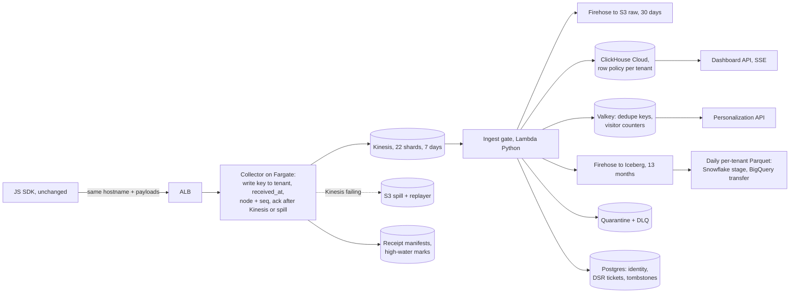

# Details behind ANSWER.md

The full tables and arithmetic that the 4-page answer summarizes. Section numbers match `ANSWER.md`. Number labels follow the same four tiers: [Observed], [Benchmarked], [Estimated], [Assumed].

### 1. The fixture, class by class

`tools/fixture_audit.py` runs the gate over the file. It reports 21 accepted, 1 duplicate, 1 quarantined, 1 dead-letter and 1 control [Observed] (`out/fixture_audit.md`).

| Class | event_ids [Observed] | Handling |
|---|---|---|
| Retry duplicate | evt-0002 (lines 2, 5): identical but for received_at, 7,428 ms later | Dedupe on (tenant_id, event_id) + content hash. Same hash: count, drop. Different: quarantine as an id conflict. |
| Client clock ahead | evt-0005 +47 s; evt-0006 exactly +65:00.000 (bad offset, not drift); evt-0016 +1 year | Past +5 s [Assumed], use received_at. Partition on server time, or evt-0016 lands in a 2027 partition that TTL and deletion skip. |
| Legacy payload | evt-0009: `pageview`, `timestamp`, `page_path`, `ref`, no received_at | Map to the canonical shape and flag it; the SDK can't change. No collector stamp: Kinesis arrival time stands in, so it still moves counters (tested). |
| No tenant | evt-0011 | Quarantine; never infer one. A payload tenant_id that contradicts the write key is quarantined too (tested). |
| PII in properties | evt-0007 `contact_email`, `phone` | HMAC (per-tenant key) before every store but the raw archive. evt-0022 links anon-3d0 to u-7304, so it is in u-7304's deletion scope. |
| Scanner | evt-0012..0015: anon-8fc, 4 page views in 50 ms, referrer `scanner.example-bot.net` | Flag, keep, and exclude from dashboards and segments. The referrer rule catches all four live (tested); the rate rule only the 4th, so the nightly repair drops the rest. |
| Privacy request | evt-0017 GDPR delete, u-1077 / anon-77a | Unverified deletion ticket; not analytics. |
| Truncated JSON | evt-0020 (line 21, no final `}`) | Dead-letter the raw bytes and count them. No repair. |
| Null field | evt-0004 `"referrer": null`, a string elsewhere | Stored as an empty string, not rejected (tested). |
| Client aggregate | evt-0019 `viewed_pricing`, `count_today: 3` | Custom event. Segments use raw page views. |
| Identity | identify evt-0003, 0008, 0022; evt-0016, evt-0024 carry both ids | Identify calls link ids within a tenant. evt-0016 and evt-0024 stay unmerged candidates: any page code can set user_id. A second user claiming an anonymous id is flagged, not merged (tested). |

**Not taken at face value.**

1. **evt-0017.** Unauthenticated, so anyone can request anyone's deletion. Also insufficient: u-1077 has no events by user_id, and the only data in scope, evt-0006, is reached via the request's own unconfirmed anon-77a [Observed] (`deletion_scope`, `out/fixture_audit.json`). The tenant verifies it.
2. **evt-0019's "viewed pricing 3x".** A client assertion. The sample shows one pricing view for u-5511 (evt-0001, via evt-0003) [Observed], so segments ignore client counters.
3. **Matching counts.** t-042 has 2 /pricing views naively and 2 after the gate, but they are different events: the naive count includes bot evt-0012 and misses legacy evt-0009 [Observed]. Count parity would pass it, so the migration also samples event ids.
4. **received_at order.** Line 5 (14:02:27) follows line 4 (14:03:44) [Observed], so Kinesis arrival time is kept too.

**Not concluded from 25 rows:** production rates, the SDK's retry policy, where the 3% loss happens, and latency; the 163 ms median transit [Observed] (n=17, `out/fixture_audit.json`) relies on client clocks.

### 2. Architecture

| Layer | Choice | Rejected, and why |
|---|---|---|
| Edge | ALB + small Node collector on Fargate, ~$170/mo [Estimated] | **API Gateway:** ~$1.4K/mo [Estimated], plus a Lambda per request to map write keys and legacy bodies. |
| Buffer | Kinesis, provisioned for the spike all year (22 shards) | **On-demand:** $244 vs $583 normally, $866 vs $644 in a Black Friday month [Estimated]; it absorbs 2x the prior 30-day peak, then throttles ~15 min [Benchmarked]. |
| Processing | Python Lambda on the event source mapping, batch size 1,000 (default 100 [Benchmarked]) so one poll a second clears 789/s; bisect on error; poison batches to SQS | **Managed Flink:** Java-first, for state that is just counters and a dedupe window. |
| Dashboards | ClickHouse Cloud (Scale), PrivateLink | **Self-managed:** ~$600/mo cheaper [Estimated], ~0.25 engineer [Assumed]. |
| Lake | Firehose Direct PUT to Iceberg, one flat event per record, `AppendOnly`; a Direct PUT quota raise past 5 MiB/s [Benchmarked] (AWS docs) filed in Phase 0 | **Warehouse connectors in v1:** auth and schema drift per warehouse. |

**Event:** keyed (tenant_id, event_id), with client and server time, node and sequence, flags and JSON properties (`schema/clickhouse.sql`). **Identity:** audited edges in Postgres, mirrored to a ClickHouse dictionary and resolved at query time; no history rewrites or probabilistic merges, which can't be undone. **Personalization:** one Valkey lookup at render, so page latency never depends on analytics load. "Viewed pricing 3x" is three non-bot views of the tenant's pricing paths by one person (identify-linked ids) in 7 days [Assumed]; legacy `pageview` counts (evt-0009), client counters don't (evt-0019).

**ClickHouse:** a ReplacingMergeTree ordered by (tenant_id, event_id), partitioned by received_at month (`schema/clickhouse.sql`). Merges collapse copies only within a partition, and a late retry can land in the next month, so exact reads and the nightly repair use `LIMIT 1 BY`, not FINAL. Dashboards read a per-minute rollup, a materialized view over `path` and `is_bot` (the gate lifts both out of properties). Views never retract, so the repair rebuilds each closed day minus late-flagged bots and swaps the partition in (`schema/jobs.sql`; not executed).

### 3. Sizing

- **Volume:** 50M events/day [Assumed] (brief) averages 579/s, with a diurnal peak of 1,736/s [Assumed] (3x). The conservative 10x of that peak is 17,361/s [Estimated]. With 1.25 headroom [Assumed] at 1,000 records/s per shard [Benchmarked], that needs 22 shards.
- **Bandwidth:** at 1 KB/event [Assumed] (the fixture averages 230 B [Observed]), the spike is 17.8 MB/s [Estimated]. That is 0.8 MB/s per shard against Kinesis's 1 MB/s [Benchmarked].
- **Gate CPU:** ~50K records/s on one M4 core [Observed] (`out/drill_clean.json`, varies by run); the sheet budgets 0.2 ms/record [Estimated], 5K/s per shard against 789/s.

| `tools/cost_sheet.py` [Estimated] | Normal month | Black Friday month (72 h at spike) | Stress: all hours at spike |
|---|---:|---:|---:|
| Events in the month | 1.5B | 5.85B (3.9x) | 45.6B (30.4x) |
| Total, incl. staging and 20% reserve | $6,913 | $8,275 | $20,719 |

`tests/test_prices.py` checks every AWS price against its Price List sku [Benchmarked] (2026-10-29/30). **Not included:** legacy's bill during the parallel run, which I don't know and where the ceiling would bind. `docs/changed_constraints.md` covers a $10K budget, own-account-only, EU residency and 72 h deletion.

**Latency p95:** ~2.6 s [Estimated], unmeasured: the Lambda poll's ≤1 s [Benchmarked] (AWS docs) plus 1.6 s of assumed stages [Assumed]. Phase 1 can't exit until a canary shows p95 under 5 s.

### 4. Guarantees and failure design

- **Collector to Kinesis:** at-least-once (SDK to collector is best effort; canary pages measure it). The 2xx comes only once every record in the PutRecords call is in; a 200 can still carry `FailedRecordCount`, and those records are retried. If Kinesis fails for 2 s [Assumed], the collector spills to S3, acks, and replays later; 503 is the last resort.
- **Kinesis to stores:** at-least-once with idempotent effects. A batch's dedupe keys (Valkey, 1 h TTL [Assumed]) commit only after ClickHouse (`wait_for_async_insert=1`) and Firehose ack. A sink error aborts the batch; Kinesis redelivers it and ClickHouse collapses the copies. Counters increment in the same Valkey script as the commit, one per tenant (`{tenant}` hash tags), since a cluster script can't cross slots. Events of untrusted age (skewed clock, past TTL, replay) skip live counters and triggers until the nightly rebuild.
- **Drill:** a 1M-event run injected 70 partial sink failures and post-commit crashes. Both sinks hold every expected event and nothing else, and no counter double-incremented; 1.5% of rows written to the ClickHouse stand-in (a dict) are copies for the store to collapse [Observed] (`out/drill_clean.json`). Marking events seen before the sinks ack, my first version, lost 6,416 events from ClickHouse and 13,321 from the lake on the same input [Observed] (`out/drill_dedupe_before_sink.json`). It also caught a bot window on client time: 268 false flags, now 0 [Observed] (`out/bot_window_regression.json`).
- **Lake:** a Firehose 200 is not an Iceberg commit. Rejects reach the error prefix after the batch committed; a reconciler re-drives them, and a daily per-tenant count checks lake against ClickHouse.
- **Backpressure:** Kinesis holds 7 days. Iterator age over 60 s [Assumed] shows dashboards' "data as of" time; over 1 h [Assumed] pages someone. Segments and exports serve their last state meanwhile.
- **Loss is detected, not assumed:** each collector incarnation persists its acked high-water mark every second, and any gap below it is loss. The drill dropped 214 records between collector and gate, and the marks alone found all 214 [Observed] (`out/drill_loss.json`). A crashed node's last second is unverifiable (23 records in the drill).

### 5. Compliance as layout

**Isolation:** tenant from the write key only. By default ClickHouse lets a user no row policy names read every row (ClickHouse docs), so each table has a permissive deny-all policy (`USING 0 TO ALL`) beside the per-tenant ones (`schema/access.sql`). A restrictive deny-all would be ANDed with every policy and hide all rows. Exports go to per-tenant prefixes.

**PII:** HMAC'd everywhere but raw and dead-letter bytes. Those are encrypted, restricted and expire at 30 days [Assumed]. HMAC tokens are still personal data.

**Deletion:** a tenant-verified request resolves the scope (user_id plus identify-linked anonymous ids) and writes tombstones, which the gate enforces on every path, replays included (tested on evt-0006 [Observed]). Then:

| Copy | Action | Done when |
|---|---|---|
| Kinesis, S3 spill | Immutable; gate suppresses | Aged out, ≤7 days |
| Valkey | Delete keys | Immediately |
| ClickHouse | Daily `ALTER TABLE … DELETE` (rewrites parts; lightweight DELETE only masks) | `system.mutations` is_done; default backups expire 24 h later [Benchmarked] |
| Raw, quarantine, DLQ (S3) | Daily Athena lookup, rewrite objects | Object list in audit row |
| Iceberg lake | Athena DELETE, expire snapshots | VACUUM done |
| Postgres | Delete edges; keep ticket with hashed ids | RDS backups expire, 7 days [Assumed] |

Every copy we hold is gone within 14 days [Assumed] of verification, inside GDPR's one month (Art. 12(3)) and CCPA's 45 days (§1798.130) [Benchmarked]. Tenant warehouses get a deletion manifest.

### 6. Migration

| Phase | Weeks | Ships | Exit / rollback |
|---|---|---|---|
| 0 Measure | 1-3 | Canaries measure legacy loss; list every reader of legacy Postgres and Redis; subprocessor notice (ClickHouse, SOC 2 [Benchmarked]) | Baseline published |
| 1 Shadow | 3-8 | Legacy tees async to Kinesis per tenant, with manifests; nightly gate | A1-A4 hold 14 days [Assumed] |
| 2 MVP | 8-12 | Real-time dashboards for 10-20 opt-in tenants | Read flag, seconds |
| 3 Edge | 13-20 | Collector takes the hostname at ALB weights 1→5→25→50→100%; an adapter keeps legacy Postgres fed | Weight to zero on 5xx >0.1%/5 min, p99 >300 ms, throttling, A1 failure, cross-tenant read, failed deletion test, cost forecast >$50K [Assumed] |
| 4 Full | 21-26 | Segments, triggers, exports, deletion automation; legacy read-only 30 days, then off | Per-cohort flag |

**"Data accuracy verified"** means four checks hold in every tenant-hour. `tools/cutover_gate.py` runs them and exits 0 PASS, 3 HOLD, 2 ROLLBACK.

- **A1 completeness:** edge = the sum of all six buckets, exactly. Surplus fails too, so no tenant offsets another.
- **A2 quality:** quarantine + dead-letter ≤0.5% [Assumed]; below 1,000 records [Assumed], any bad record needs review.
- **A3 denominator:** legacy rows ≤ edge count, or the manifest is incomplete.
- **A4 freshness:** canary p95 under 5 s. Unmeasured means HOLD.

1,000 edge event_ids a day [Assumed] are also looked up in both stores (the t-042 lesson). On drill data the clean run ends in HOLD (A4 unmeasurable; 131 small tenants need review), and the loss run in ROLLBACK, naming 92 tenants [Observed] (`out/cutover_*.txt`). **People:** A owns edge, Kinesis and migration; B owns gate, ClickHouse and dashboard API; mid-levels build the UI from Phase 2.

### 7. Trade-offs and scope

**Accepted:** duplicates the store collapses, not exactly-once; bad-clock counters wait for the nightly rebuild; one region. **MVP leaves out** triggers, segment builder, warehouse connectors, self-serve deletion. **Later:** SDK v2 with sequence numbers, multi-region, per-tenant KMS keys.
